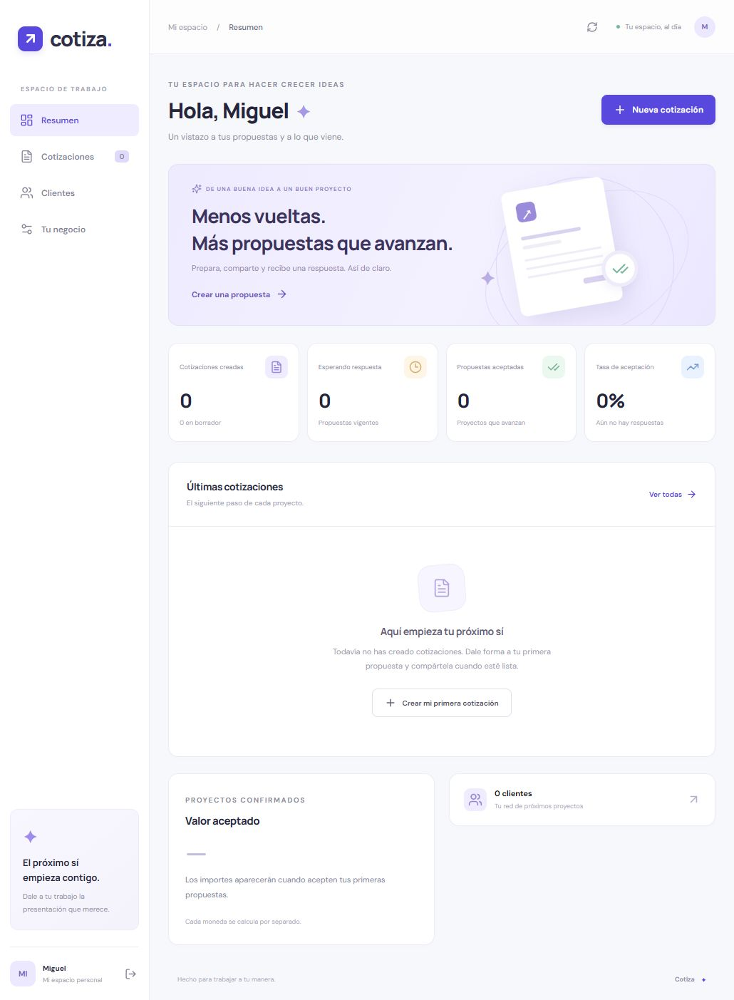

# Cotiza

Cotizaciones claras, del primer borrador a la respuesta del cliente.

Cotiza es una aplicación web de código abierto para freelancers y pequeños negocios. Permite organizar clientes, preparar propuestas con precios y condiciones, y compartirlas mediante un enlace privado. Se instala en tu propio servidor y guarda los datos en SQLite.

**Self-hosted quotes and proposals, built with React, Node.js and SQLite.**



## Qué puedes hacer

- Gestionar clientes y los datos de tu negocio.
- Crear cotizaciones con varios conceptos, cantidades decimales, descuentos e impuestos.
- Trabajar con USD, PEN, EUR, MXN, COP, CLP, ARS o GBP.
- Editar borradores y duplicar propuestas para preparar una nueva versión con otro número.
- Compartir una propuesta mediante un enlace privado que puedes renovar o revocar.
- Recibir una aceptación o un rechazo con el nombre del cliente y la fecha de respuesta.
- Imprimir la propuesta o guardarla como PDF desde el navegador.
- Consultar estados, buscar propuestas y exportar tus datos como JSON.

Cada cuenta tiene su propio espacio. La instalación empieza vacía: no hay usuarios predeterminados, clientes de muestra ni cotizaciones precargadas.

## Requisitos

Node.js 22.13 o superior y npm. SQLite viene incluido en Node; no necesitas instalar un servidor de base de datos. Node 22 muestra un aviso experimental al usar SQLite.

## Ponerlo en marcha

Clona el repositorio y entra a la carpeta:

```sh
git clone https://github.com/MIGUEL-MOSCOSO-DEV/cotiza.git
cd cotiza
npm ci
npm run dev
```

Abre **http://localhost:3000** y crea tu cuenta. En **Tu negocio** puedes configurar el nombre comercial, los datos de contacto, la moneda y las condiciones que se copiarán en las nuevas cotizaciones.

Para usar la compilación de producción:

```sh
npm run build
npm start
```

## Configuración

La configuración inicial funciona en local sin crear ningún archivo. Si necesitas cambiarla, copia **.env.example** a **.env** y ajusta estas variables:

- **PORT**: puerto del servidor; por defecto, 3000.
- **HOST**: interfaz de escucha; por defecto, 127.0.0.1. Usa 0.0.0.0 dentro de Docker o cuando lo requiera tu alojamiento.
- **APP_URL**: dirección desde la que se abre la aplicación. Se utiliza para generar los enlaces privados y comprobar el origen de las solicitudes. Debe coincidir con la dirección del navegador.
- **DATABASE_PATH**: ruta del archivo SQLite; por defecto, ./data/cotiza.sqlite. Las rutas relativas se resuelven desde la carpeta del proyecto.

Para compartir propuestas fuera de tu equipo, instala Cotiza en un servidor con un dominio y HTTPS, configura **APP_URL** con ese dominio y conserva el directorio de datos en almacenamiento persistente. Los enlaces de localhost solo funcionan en tu propio equipo. Con HTTPS, las cookies se envían con el atributo Secure.

El servidor no confía automáticamente en cabeceras de proxy. Si lo pones detrás de un proxy inverso, configura la confianza en el proxy según tu infraestructura antes de ajustar los límites por IP.

## Cómo funciona una propuesta

Una cotización empieza como borrador. Puedes modificar sus datos o eliminarla mientras siga en ese estado.

Al compartirla, Cotiza conserva una copia de los datos del cliente, del negocio y de los importes. Esa propuesta queda fijada aunque cambies después la información de contacto. Si necesitas otros precios o condiciones, duplícala y comparte la nueva cotización.

El enlace permite ver la propuesta y responder una sola vez mientras esté vigente. Renovarlo invalida el enlace anterior. Revocarlo retira el acceso público y conserva el documento y su respuesta en tu cuenta. Guarda el enlace al crearlo: el servidor almacena su huella, no el token original.

La validez termina al finalizar la fecha indicada en UTC. La respuesta registra el nombre declarado por el visitante; no verifica su identidad ni incorpora firma electrónica certificada. Cotiza no emite comprobantes fiscales ni procesa pagos.

## Datos y copias de seguridad

Los datos viven en el archivo indicado por **DATABASE_PATH**. Para una copia completa, detén la aplicación y copia el archivo SQLite antes de volver a iniciarla. Guarda esa copia fuera del servidor. No copies únicamente el archivo principal mientras haya escrituras: SQLite utiliza archivos WAL auxiliares.

La exportación JSON disponible en **Tu negocio** sirve para consultar o trasladar la información de una cuenta. No incluye contraseñas, sesiones ni tokens. No sustituye a una copia completa de SQLite y esta versión no incluye un importador JSON.

## Desarrollo

```sh
npm test
npm run check
npm run format:check
npm run build
```

Las pruebas usan una base de datos en memoria y no escriben en los datos de la aplicación. Cubren cálculo y redondeo de importes, aislamiento entre cuentas, sesiones, enlaces privados, vencimientos y respuestas.

El proyecto está organizado en cuatro partes:

- **src/**: interfaz React y estilos adaptables.
- **server/**: API Express, autenticación, validación y acceso a SQLite.
- **shared/**: cálculo de importes y estados compartidos entre cliente y servidor.
- **tests/**: pruebas con el runner nativo de Node.

Los precios se almacenan como céntimos enteros. Cada concepto se redondea antes de aplicar el descuento; el impuesto se calcula sobre la base descontada. Las monedas se agrupan por separado en el resumen: no se convierten ni se suman entre sí.

Las contraseñas se derivan con scrypt y una sal aleatoria. Las sesiones usan cookies HttpOnly y tokens aleatorios cuya huella se guarda en la base de datos. Los permisos se comprueban en el servidor. La API valida entradas con Zod, usa consultas parametrizadas y aplica límites a los intentos de acceso y a las respuestas públicas.

El registro de cuentas está abierto. Si necesitas una instalación privada, restringe el acceso desde tu proxy o tu red.

Esta versión no incorpora recuperación de contraseña, verificación de correo, envío de emails ni cobros. Los enlaces se comparten manualmente. La aplicación usa fuentes web de Google Fonts, con fuentes del sistema como alternativa.

## Contribuir

Si encuentras un error, abre un issue con los pasos para reproducirlo. Para proponer un cambio, explica qué problema resuelve e incluye pruebas cuando afecte a importes, permisos o estados de una propuesta.

## Licencia

[MIT](LICENSE). Puedes usar, modificar y distribuir Cotiza respetando la licencia.

Desarrollado por [Miguel Moscoso](https://github.com/MIGUEL-MOSCOSO-DEV).
